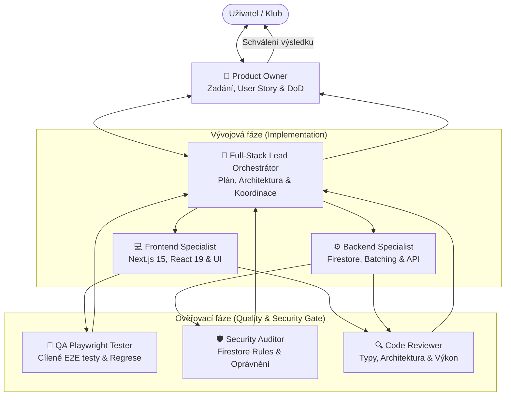

# Team Orchestration Protocol: HC Aces HUB

Tento protokol definuje týmovou orchestraci a dělbu práce mezi specializovanými agenty při vývoji, testování a nasazování funkcí do aplikace **HC Aces HUB**.

---

## 1. Schéma týmové spolupráce

---

## 2. Pět fází životního cyklu úkolu (5-Stage Delivery Cycle)

### Fáze 1: Zadání & Akceptační kritéria (Product Owner)
* **Zodpovědnost:** `product-owner`
* **Vstup:** Požadavek uživatele (např. *„Chci přidat novou funkci hlasování o hvězdách zápasu“*).
* **Výstup:**
  * Uživatelský příběh (*User Story*).
  * Konkrétní persony (Hráč v kabině vs. Trenér vs. Admin).
  * Seznam akceptačních kritérií (*Definition of Done - DoD*).

### Fáze 2: Technický plán & Dělba práce (Lead Orchestrator)
* **Zodpovědnost:** Hlavní agent (Lead Orchestrátor)
* **Výstup:**
  * Doporučený slash command: `/plan` pro komplexní architekturu.
  * Rozpad na frontendové a backendové tasky.
  * Identifikace souborů k úpravě a prevence monolitických komponent.

### Fáze 3: Implementace (Specialisté)
* **Frontend:** `frontend-specialist` implementuje responzivní UI, mobilní kabinový pohled a přidává `data-testid` selektory.
* **Backend:** `backend-specialist` připravuje Firestore schémata, atomické `writeBatch` operace a API endpointy.

### Fáze 4: Quality & Security Gate (QA & Bezpečnost)
* **QA Playwright Tester:** Spustí **pouze cílenou testovací specifikaci** k ověření nového kódu (např. `npx playwright test tests/dashboard.spec.ts`).
* **Security Auditor:** Ověří, že nová pole či kolekce mají správná oprávnění ve `firestore.rules`.
* **Automatické ověření:** Spuštění `npm run typecheck` (0 chyb).

### Fáze 5: Code Review & Schválení (Review & Delivery)
* **Code Reviewer:** Prověří čistotu kódu, typovou bezpečnost a absenci zbytečných závislostí.
* **Product Owner:** Zkontroluje splnění Definition of Done.
* **Nasazení:** Git commit na větev `develop` a push do repozitáře.

---

## 3. Jak vyvolávat týmovou práci v Antigravity 2.0

* **Přímé oslovení role:**
  * `@product-owner specifikuj požadavky pro novou funkci X`
  * `@frontend-specialist uprav zobrazení tabulky pro mobily`
  * `@backend-specialist navrhni datový model a transakci`
  * `@qa-playwright-tester otestuj docházku v Playwrightu`
  * `@code-reviewer zkontroluj čistotu posledních změn`
* **Slash commandy pro orchestraci:**
  * `/teamwork-preview` – spuštění autonomního týmu specializovaných agentů na komplexní úkol.
  * `/plan` – vytvoření podrobného plánu krok za krokem před implementací.
  * `/grill-me` – interaktivní interview s Product Ownerem pro vyjasnění technických rozhodnutí.
  * `/boost` – režim hlubokého uvažování a multi-perspektivního prověřování.
